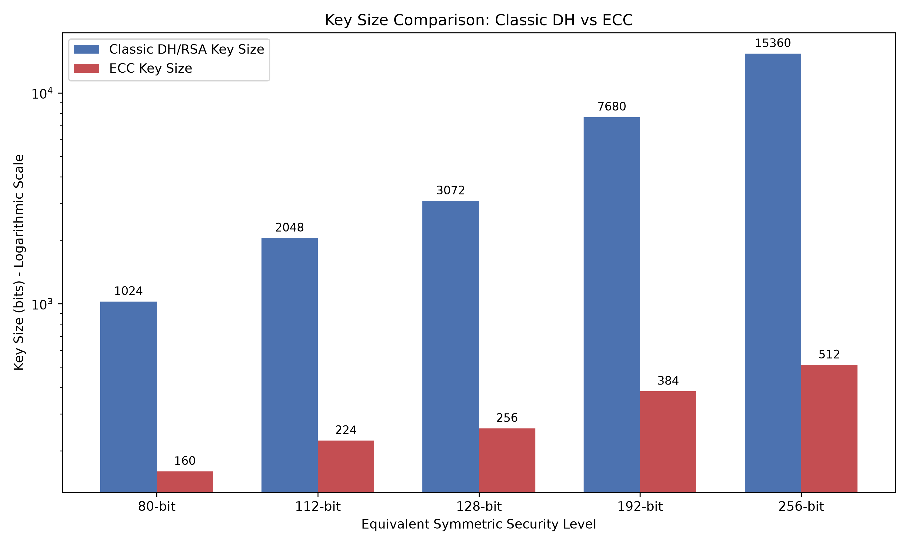
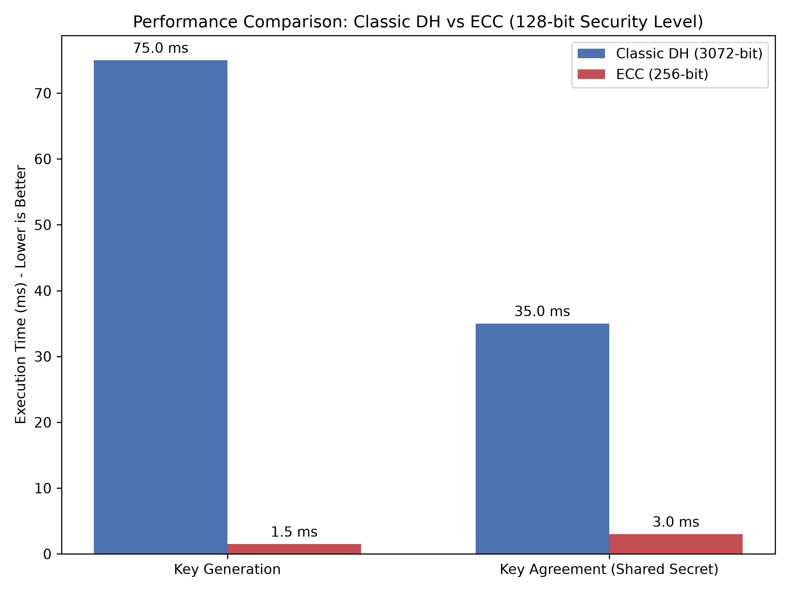

# Key Size and Performance: ECC vs DH/RSA

Elliptic Curve Cryptography (ECC) achieves equivalent security to classic Diffie-Hellman (DH) or RSA using significantly smaller key sizes and much less computational power.

### 1. Key Size Comparison

The graph below illustrates how Classic DH key sizes grow exponentially compared to ECC to maintain the same level of security.

| Symmetric Security Level | Classic DH / RSA Key Size | ECC Key Size | Size Ratio (DH : ECC) |
| :--- | :--- | :--- | :--- |
| **80-bit** | 1024 bits | 160 bits | ~ 6 : 1 |
| **112-bit** | 2048 bits | 224 bits | ~ 9 : 1 |
| **128-bit** | 3072 bits | 256 bits | 12 : 1 |
| **192-bit** | 7680 bits | 384 bits | 20 : 1 |
| **256-bit** | 15360 bits | 512 bits | 30 : 1 |

### 2. Performance Comparison (128-bit Security)

Because the numbers involved in ECC are much smaller (e.g., 256-bit vs 3072-bit), the mathematical operations are vastly more efficient.

* **Key Generation**: Generating an ECC key requires finding a random number and doing one scalar multiplication on the curve. This is virtually instantaneous (`< 2 ms`). Classic DH requires generating large prime numbers and checking primality, which is very slow.
* **Key Agreement (Shared Secret)**: Computing the shared secret in ECC is about **10x to 15x faster** than Classic DH because elliptic curve scalar multiplication over a 256-bit field is significantly less intensive than modular exponentiation over a 3072-bit field.

> [!TIP]
> This speed advantage is exactly why ECC is highly preferred in heavy-load scenarios, such as the Load Balancer implementation in your LAN file transfer architecture. When many clients request connections simultaneously, a traditional DH server would hit a CPU bottleneck much faster than an ECDH server!
